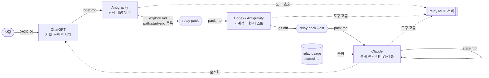

# effiency — relay

> **Claude Max → Pro (토큰 1/5) 로 내려가도 같은 양의 일을 하기 위한 멀티 AI 워크플로우 플랫폼**
> ChatGPT · Antigravity · Claude 를 **파일 기반 인수인계 프로토콜**로 하나의 파이프라인에 묶고,
> 토큰 사용량을 **측정 → 예산화 → 경고**하는 CLI `relay` 를 제공한다.

---

## 1. 문제 정의

| | 현재 | 목표 |
|---|---|---|
| Claude 플랜 | Max 5x | Pro (Max 5x 대비 사용량 약 1/5) |
| 추가 구독 | ChatGPT Plus | 그대로 유지 (Codex CLI 포함) |
| 무료/저비용 | Antigravity (`agy`) | 탐색·대량 읽기 전담 |
| 요구 효율 | 1x | **Claude 기준 5x** |

### 측정해 보니 — 토큰의 93% 가 cache read

이 저장소를 만든 Claude Code 세션 자체를 `relay usage` 로 측정한 값:

```
                         req    input  c.write   c.read   output  read%  avg ctx
2026-10-12                16       32    62.1k     1.3M    34.8k    93%    85.5k
```

- **첫 요청부터 컨텍스트가 약 67k 토큰**이었다 (시스템 프롬프트 + 도구 정의 + MCP 서버). 아무 일도 안 했는데 이만큼이다.
- 요청 16번 만에 cache read 가 1.3M. 요청 1회(= tool call 1회)마다 **그 시점의 컨텍스트 전체를 다시 읽기** 때문이다.

## 2. 핵심 아이디어 — 비용 모델

```
Claude 비용 ≈ Σ(요청마다 다시 읽는 컨텍스트)
           = 요청 수 × base  +  growth × 요청 수² / 2
             └─ 고정비 ─┘       └── 세션이 길수록 이차로 증가 ──┘
```

세션 하나에 요청 100번이면 이차 항이 지배한다. 그래서 세 가지 레버가 곱으로 작동한다.

| 레버 | 방법 | relay 기능 |
|---|---|---|
| ① 요청 수 ↓ | 탐색·보일러플레이트를 Antigravity / Codex / ChatGPT 로 오프로드 | `route`, `handoff` |
| ② 세션 길이 ↓ | 긴 대화 대신 `state.md` 로 인수인계하고 `/clear` | `/handoff`, `/pickup`, `statusline` |
| ③ 컨텍스트 크기 ↓ | Claude 가 직접 탐색하지 않고 필요한 조각만 담은 pack 을 받음 | `pack --refs / --outline / --diff` |

```console
$ relay estimate --requests 100 --sessions 1 --offload 0.5 --after-sessions 2
현재 : 요청 100회 / 세션 1개 / base 20.0k → 컨텍스트 재독 11.9M
변경 : 요청 50회 (오프로드 50%) / 세션 2개 / base 20.0k → 2.2M
효율 : x5.4
```

요청을 절반만 넘기고 세션을 둘로 나누기만 해도 계산상 5배를 넘는다. 자세한 유도와 한계는 [docs/architecture.md](docs/architecture.md).

## 3. 아키텍처



**인수인계의 단위는 대화가 아니라 파일**이다. 모든 도구가 `.relay/tasks/<id>/` 를 읽고 쓴다.
v0.2 부터는 Claude Code · Codex · Antigravity 가 이 폴더를 **relay MCP 서버**의 도구 호출로 직접 읽고 쓴다 (복붙 제거) → [docs/mcp.md](docs/mcp.md)

| 파일 | 작성 | 읽는 쪽 |
|---|---|---|
| `brief.md` | 사람 + ChatGPT | 전원 |
| `explore.md` | Antigravity | `relay pack --refs` |
| `pack.md` | `relay pack` | Claude, Codex |
| `state.md` | 진행 중인 에이전트 (`/handoff`) | 다음 세션 (`/pickup`) |
| `out-<agent>.md` | 각 에이전트 | 사람, 다음 단계 |

### 역할 분담 원칙

| 도구 | 맡는 일 | 이유 |
|---|---|---|
| **ChatGPT** (웹 / 앱) | 아이디어 → brief, 리서치, 문서, 2차 리뷰 | 대화형 작업은 Claude 토큰을 0 쓴다 |
| **Antigravity** (`agy`) | 저장소 탐색, 큰 파일 읽기, 구조 파악, 브라우저 테스트 | 컨텍스트를 가장 많이 먹는 일을 별도 쿼터로 |
| **Codex CLI** (ChatGPT Plus) | 보일러플레이트, 테스트 작성, 반복 리팩터링 | 규칙이 명확한 구현은 어느 모델이 해도 비슷하다 |
| **Claude** (Pro) | 설계 결정, 원인 불명 버그, 보안·동시성, 최종 리뷰 | 비싼 토큰은 판단이 필요한 곳에만 |

## 4. 빠른 시작

```bash
pip install git+https://github.com/cogito5170/effiency.git   # 또는 clone 후 pip install -e .

cd ~/your-project
relay init --statusline --mcp      # AGENTS.md · CLAUDE.md · .agent/ · .claude/commands · .relay/ · .mcp.json 설치
relay mcp-config codex             # → ~/.codex/config.toml 에 붙여넣기
relay mcp-config antigravity       # → Antigravity MCP 설정에 병합
relay usage --days 7 --save-baseline   # Max 플랜일 때 1주일치 기준선 저장 (중요)

relay task new "결제 웹훅 재시도 로직 추가"
relay handoff 1 --to chatgpt --copy    # → ChatGPT: brief 다듬기 → brief.md 에 붙여넣기
relay handoff 1 --to antigravity --copy  # → Antigravity: explore.md 작성
relay pack 1 --refs explore.md         # 탐색 결과 → 최소 컨텍스트
relay handoff 1 --to codex             # → Codex: 구현 + 테스트
relay pack 1 --refs explore.md --diff main
relay handoff 1 --to claude            # → Claude: 리뷰·판단 (새 세션 첫 메시지로)
relay usage                            # 기준선 대비 몇 배인지 확인
```

MCP 가 연결된 도구에서는 위 복붙 단계가 대화 한 줄로 바뀐다.

```text
Antigravity › 003 탐색해서 explore 남겨줘        → relay_task_read → relay_task_write(file="explore")
Codex       › 003 구현해줘                      → relay_task_read → (구현) → relay_task_write(file="out-codex")
Claude      › /pickup 003                      → relay_task_read (brief+state+pack 한 번에)
```

### 가장 효과가 큰 두 명령 (실측 → [docs/pipeline.md](docs/pipeline.md))

```bash
relay lean      # 대화형 Claude 를 도구 6개로: 첫 요청 컨텍스트 35.1k → 7.9k (−78%), 모든 요청에 적용
relay run       # explore(agy) → pack → implement(Codex) → verify → review(Claude lean, 1턴 ≈ 6k)
```

하루 단위 운영법은 [docs/playbook.md](docs/playbook.md). 새 세션은 [docs/HANDOFF.md](docs/HANDOFF.md) 부터 (Pro 30일 운용 계획).

## 5. 명령어

| 명령 | 설명 |
|---|---|
| `relay init [--statusline]` | 프로토콜 파일 설치. 기존 파일은 건드리지 않음 (`--force` 로 덮어쓰기) |
| `relay task new <제목>` / `list` | 작업 폴더 생성 · 추천 라우팅 표시 |
| `relay route <설명>` | 어떤 도구에 맡길지 규칙 기반 추천 (`.relay/config.toml` 로 조정) |
| `relay pack [id] --refs F --full G --outline G --diff [REF] --tree --budget N` | 예산 안에서 pack.md 생성. 예산 초과 파일은 시그니처만 남기고 강등 |
| `relay handoff [id] --to <agent> [--ask ...] [--copy]` | 에이전트별 프롬프트 생성 (`prompt-<agent>.md`) |
| `relay usage [--days N] [--source claude\|codex\|all] [--save-baseline] [--json]` | Claude Code / Codex 로컬 로그 분석, 기준선 대비 배수 |
| `relay estimate ...` | 오프로드·세션 분할 효과 계산 |
| `relay mcp [--profile claude\|explorer\|builder\|full] [--root R] [--cost]` | MCP 서버 (stdio). `--cost` 는 프로필별 도구 정의 토큰 비용 |
| `relay mcp-config <claude\|codex\|antigravity>` | 클라이언트별 설정 스니펫 |
| `relay events [--tail N]` | MCP 도구 호출 감사 로그 요약 (클라이언트 · 도구 · 공급 토큰) |
| `relay lean [--print] [-- claude 인자]` | 도구를 줄인 대화형 Claude (base −78% 실측) |
| `relay run [id] [--only/--skip 단계] [--verify CMD] [--dry-run]` | 파이프라인: explore → pack → implement → verify → review, CHANGES 면 재구현 |
| `relay why [session]` | 세션의 캐시 읽기를 원인별로 분해 (고정 부분 · thinking · Claude 가 쓴 내용 · 명령 출력 …) + 처방 |
| `relay watch [session]` | **감시자**: codex(→agy)가 세션을 보고 `CONTINUE / DELEGATE / HANDOFF / CLEAR` 판정. Claude 토큰 0 |
| `relay doctor` | 고정 부분 진단: base 크기, CLAUDE.md·@import, MCP 서버 목록, 주간 절감량 |
| `relay init --hooks` / `relay hook prompt\|pretool` | Claude Code hooks: 컨텍스트 한도 넘으면 메시지 차단, 큰 파일 전체 Read · 무제한 출력 명령 차단 |
| `relay statusline` | Claude Code 하단에 `ctx 72k ████░ · req 31 · read 1.9M · ⚠` 표시 (토큰 비용 0) |

## 6. 플랫폼 엔지니어링 관점

이 프로젝트는 "AI 도구 사용법 모음"이 아니라, 작은 규모의 **내부 개발자 플랫폼(IDP)** 으로 설계했다.

| IDP 개념 | relay 에서 |
|---|---|
| Golden path | `task → handoff → pack → handoff` 표준 경로, `relay init` 한 번으로 설치 |
| 인터페이스 계약 | `.relay/tasks/<id>/` 파일 스키마 + `path:start-end` 참조 형식 |
| 관측성 | `relay usage` (로그 기반 지표), `statusline` (실시간), `relay events` (MCP 감사 로그) |
| 정책 / 예산 | `config.toml` 의 컨텍스트·요청 예산, 라우팅 규칙, MCP 프로필별 최소 권한 · 도구 정의 토큰 예산 |
| 플랫폼 API | relay MCP 서버: 세 클라이언트가 같은 계약(task 파일)을 도구로 사용 |
| 셀프서비스 | 도구별 규칙 파일(AGENTS.md, CLAUDE.md, `.agent/rules`)을 자동 생성 |

### 로드맵

- [x] **v0.1** 파일 프로토콜 · CLI · 사용량 관측 · statusline · CI
- [x] **v0.2** relay MCP 서버: 세 도구가 task/pack 을 도구 호출로 직접 읽고 씀 (복붙 제거) · 프로필별 최소 권한 · 감사 로그 → [docs/mcp.md](docs/mcp.md)
- [x] **v0.3** 측정 → 강제: `relay why` (캐시 읽기 원인 분해), `relay doctor` (고정 부분), hooks (세션 한도 · 출력 가드)
- [x] **v0.4** `relay run` 파이프라인 (agy → Codex → Claude lean 리뷰 루프) · `relay lean`
- [ ] ChatGPT 개발자 모드용 인증된 HTTP 전송
- [ ] **v0.4** PR 파이프라인: Codex 1차 리뷰 → 위험한 diff 만 Claude 로 에스컬레이션
- [ ] **v0.5** 라우팅 품질 측정: 작업별 소요 토큰·재작업률을 기록해 규칙 자동 조정
- 검토 후 보류: 코드용 RAG — 탐색은 이미 Antigravity → pack 으로 Claude 토큰 0, 측정상 큰 비용은 고정 부분·세션 길이·thinking 이라 효과가 작음

## 7. 개발

```bash
python -m unittest discover -s tests -v   # 외부 의존성 없음 (Python 3.11+ 표준 라이브러리만)
```
