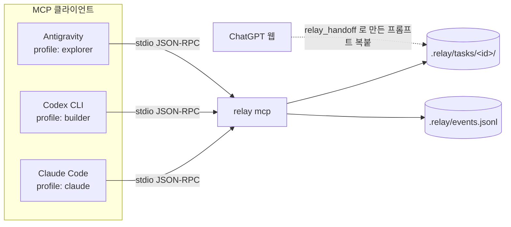

# relay MCP 서버 (v0.2)

v0.1 에서는 `relay handoff --copy` 로 프롬프트를 복사해 각 도구에 붙여넣었다.
v0.2 는 같은 작업 폴더(`.relay/tasks/<id>/`)를 **MCP 도구 호출**로 노출해, Claude Code · Codex CLI · Antigravity 가 직접 읽고 쓰게 한다.



## 설치

```bash
pip install git+https://github.com/cogito5170/effiency.git
cd ~/your-project && relay init --mcp        # Claude Code 용 .mcp.json 생성

relay mcp-config codex          # → ~/.codex/config.toml 에 추가
relay mcp-config antigravity    # → Antigravity MCP 설정(mcp_config.json)에 병합
```

| 클라이언트 | 기본 프로필 | 설정 위치 | 확인 |
|---|---|---|---|
| Claude Code | `claude` | 프로젝트 `.mcp.json` (처음 실행 시 승인) | `claude mcp list` → `✓ Connected` |
| Codex CLI | `builder` | `~/.codex/config.toml` 의 `[mcp_servers.relay]` | codex 에서 `/mcp` |
| Antigravity | `explorer` | 에이전트 패널 `…` → MCP Servers → Manage → raw config | MCP 목록에서 relay 활성 |

Codex · Antigravity 설정은 전역 파일이라서 `mcp-config` 는 기본으로 `--root <현재 프로젝트>` 를 넣는다.
여러 프로젝트에서 쓰려면 `--no-root` 로 만들고, 서버가 클라이언트의 **MCP roots** 또는 실행 디렉터리에서 프로젝트를 찾게 둔다.
루트를 고르는 우선순위: `--root` → `$RELAY_ROOT` → 클라이언트 roots (`.relay/` 가 있는 것 우선) → 서버 cwd.

> Antigravity 의 MCP 설정 메뉴 경로는 버전에 따라 다를 수 있다. JSON 형식(`mcpServers`)은 같다.

## 도구

| 도구 | 하는 일 | claude | explorer | builder | full |
|---|---|:-:|:-:|:-:|:-:|
| `relay_task_list` | 작업과 파일 목록 | ✓ | ✓ | ✓ | ✓ |
| `relay_task_read` | brief · state · pack 등을 한 번에 읽기 | ✓ | ✓ | ✓ | ✓ |
| `relay_task_write` | task 파일 쓰기 (프로필별 허용 파일만) | ✓ | ✓ | ✓ | ✓ |
| `relay_task_create` | 작업 생성 + 추천 라우팅 | ✓ | | | ✓ |
| `relay_pack` | 예산 안에서 pack.md 생성 | ✓ | | ✓ | ✓ |
| `relay_route` | 작업 설명 → 추천 에이전트 | ✓ | | | ✓ |
| `relay_handoff` | MCP 없는 도구(ChatGPT 웹)용 프롬프트 파일 | | | | ✓ |
| `relay_usage` | Claude/Codex 로컬 로그 요약 | | | | ✓ |

| 프로필 | 쓸 수 있는 파일 |
|---|---|
| `claude` | brief, state, out-claude |
| `explorer` | explore, state, out-antigravity |
| `builder` | state, out-codex |
| `full` | brief, state, explore, out-* |

## 설계 결정

### 1. 도구 정의도 토큰이다

MCP 도구의 이름 · 설명 · 스키마는 **매 요청 base 컨텍스트**에 들어간다 ([architecture.md](architecture.md) 의 `N·base` 항).
도구 50개짜리 서버 하나를 붙이면 Claude 에게 넘긴 일을 줄여 아낀 토큰이 그대로 사라진다. 그래서:

- 설명은 짧은 영어로 쓴다 (한글은 글자당 약 1토큰, 영어는 4자당 약 1토큰).
- 프로필마다 필요한 도구만 노출한다.
- 예산을 테스트로 고정한다 (`tests/test_mcp.py::test_definitions_stay_small`).

```console
$ relay mcp --cost
claude    ~ 544 tok/요청  tools=6  write=brief,state,out-claude
explorer  ~ 251 tok/요청  tools=3  write=explore,state,out-antigravity
builder   ~ 423 tok/요청  tools=4  write=state,out-codex
full      ~ 685 tok/요청  tools=8  write=brief,state,explore,out-*
```

`claude` 프로필은 요청당 약 544 토큰을 더한다. base 가 20k 라면 약 2.7% 다. 그 대가로 Claude 가 `Glob`/`Read` 를 여러 번 하는 대신 `relay_task_read` 한 번으로 시작할 수 있다.

### 2. 최소 권한

- task 파일 이름은 `brief|state|pack|explore|out-<agent>|prompt-<agent>` 만 허용한다. 경로 구분자가 들어갈 수 없다.
- 프로필마다 쓰기 허용 목록이 다르다. 탐색 담당(Antigravity)이 brief 를 바꾸거나, 구현 담당(Codex)이 Claude 의 결과를 덮어쓸 수 없다.
- `relay_pack` 의 refs · full · outline 경로는 프로젝트 루트 밖(`../`, 절대경로, 루트 밖을 가리키는 심볼릭 링크)을 읽지 않는다.
- 쓰기 크기 상한은 200k 자다.

### 3. 감사 로그

모든 도구 호출이 `.relay/events.jsonl` 에 남는다: 시각, 클라이언트(`initialize` 의 clientInfo), 프로필, 도구, task, 성공 여부, 돌려준 토큰(근사), 소요 시간.

```console
$ relay events --tail 3          # 출력 형식 예시 (숫자는 가상)
client              tool                 calls errors  tok out
claude-code         task_read                4      0     6.2k
codex               task_write               3      1      120
...
```

"relay 가 각 에이전트에게 컨텍스트를 얼마나 공급했나"를 볼 수 있다. 권한 오류가 반복되면 프롬프트나 프로필이 잘못된 것이다.

### 4. 의존성 없는 구현

공식 MCP SDK 대신 표준 라이브러리로 JSON-RPC 2.0 stdio 전송을 직접 구현했다 (`relay/mcp_server.py`, 약 380줄).

- `initialize` 에서 프로토콜 버전을 협상한다 (지원: 2025-11-25, 2025-06-18, 2025-03-26, 2024-11-05).
- `tools/list`, `tools/call`, `ping`, 알림, 배치, 파싱 오류(-32700)를 처리한다.
- 클라이언트가 `roots` 를 지원하면 `notifications/initialized` 뒤에 서버가 먼저 `roots/list` 를 요청한다.
- stdout 에는 JSON-RPC 메시지만 쓴다.

검증: 단위 테스트 + 실제 프로세스를 띄우는 stdio 테스트 + Claude Code CLI(2.1.296)의 `claude mcp get relay` 에서 `✓ Connected`.

## 한계와 다음 단계

- **ChatGPT 웹/앱은 로컬 stdio MCP 에 붙을 수 없다.** 원격 HTTPS 서버가 필요하다. 로컬 파일을 쓰는 서버를 인터넷에 노출하려면 인증이 반드시 필요해서 v0.2 범위에서 뺐다. 지금은 `relay_handoff` 로 프롬프트 파일을 만들어 붙여넣는다. ChatGPT 구독 쪽 자동화는 같은 구독에 포함된 Codex CLI 가 맡는다.
- 다음 후보: 읽기 전용 + 토큰 인증 Streamable HTTP 전송 (ChatGPT 개발자 모드 연결용), MCP prompts 로 `/pickup` · `/handoff` 를 클라이언트 공통 명령으로 제공.
